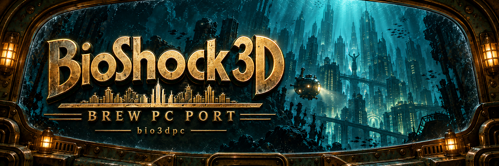

# BioShock 3D PC Port

[English](README.md) · **Español**



Preserva y juega **BioShock 3D**, el juego móvil de BREW de 2010, en un PC con Linux. `bio3dpc` ejecuta el código ARM original mediante Unicorn; Python proporciona el runtime de BREW, los controles de escritorio, el audio y una ventana de tkinter.

**Debes aportar tu propio juego:** los módulos y datos originales de BREW no se incluyen ni se descargan. Las ediciones **LG VX8350 vertical** y **Nokia 7705 horizontal** tienen perfiles separados. Ambas llegan al juego; no se ha verificado la campaña completa y la colección de Nokia carece de los paquetes posteriores.

[Jugabilidad](#jugabilidad) · [Inicio rápido](#inicio-rápido) · [Archivos del juego](#archivos-del-juego) · [Controles](#controles) · [Desarrollo](#desarrollo)

## Jugabilidad

Grabaciones reales del framebuffer, ampliadas al doble con escalado por vecino más cercano. Estos bucles sin sonido muestran el juego en ejecución; el arte generado del lanzador es independiente.

| LG VX8350 · 176×220 vertical | Nokia 7705 · 320×240 horizontal |
| --- | --- |
|  |  |
| v1.4.1.1 · requiere siete paquetes de campaña compatibles | v1.5.2.1 · solo hay dos paquetes de campaña disponibles |

Consulta la [cobertura de versiones](docs/builds.md) (en inglés) para conocer los límites de cada edición.

## Requisitos

- **Linux x86_64**, Python 3 con **tkinter** y GNU Make. El desarrollo ha utilizado Python 3.14.
- Dependencias de Python instaladas desde `requirements.txt`, incluidas Unicorn y Capstone.
- **FFmpeg** y **`paplay`** en `PATH` para efectos de sonido y voces.
- **FluidSynth** y un **SoundFont** para la música MIDI. Sin SoundFont, la música permanece en silencio, pero mantiene su duración.

Coloca un archivo `.sf2` en `~/.local/share/soundfonts/` o define `BIO3DPC_SOUNDFONT`. La falta de herramientas de audio permite seguir jugando sin sonido. Consulta los [detalles de audio](docs/advanced-usage.md#midi) (en inglés).

## Inicio rápido

Instala Python, tkinter y Make; después ejecuta:

```sh
git clone https://github.com/aurelioochoa/bio3dpc.git
cd bio3dpc
make venv
./bio3dpc.sh
```

Elige la edición, abre **Installation**, selecciona el módulo de BREW y su carpeta de datos compatibles, y pulsa **Verify files**. Tras verificar, usa **Save and return → Play**.

Para instalar la entrada del menú de aplicaciones y el comando `~/.local/bin/bio3dpc`:

```sh
make install-desktop
```

Conserva el repositorio en su ubicación. `make uninstall-desktop` elimina la entrada y el comando instalado; conserva las preferencias, partidas y archivos originales.

## Archivos del juego

Aporta los **archivos extraídos de BioShock 3D para BREW** y conserva sus nombres originales:

| Edición | Módulo y datos compatibles |
| --- | --- |
| LG VX8350 · v1.4.1.1 | `bio3d.mod`, `bio3d.idx` y `bio1.dat` hasta `bio7.dat` |
| Nokia 7705 · v1.5.2.1 | `bio3d.mod`, `bio3d.idx`, `bio1.dat` y `bio2.dat` compatibles; faltan los paquetes posteriores |

En **Installation**, selecciona **Original BREW module (.mod)** y **Matching game data folder (.dat + .idx)**. Elige la carpeta que contiene los datos, no su carpeta superior. La verificación comprueba los hashes del módulo y de los recursos iniciales, además de los nombres de paquetes requeridos; no demuestra cobertura de toda la campaña. Los archivos de otros teléfonos no son sustitutos compatibles.

**Los archivos se usan en su ubicación original:** el lanzador recuerda sus rutas sin copiarlos ni modificarlos. Mantén disponible la carpeta o unidad externa durante el juego. No se admiten APK, IPA, JAR ni ROM de consola. Consulta las [identidades y cobertura de versiones](docs/builds.md) y la [guía detallada de instalación](docs/advanced-usage.md#installation-bring-your-own-game-files) (en inglés).

## Lanzador


El lanzador de batisfera permite elegir edición, verificar la instalación, cambiar la escala de ventana, activar el audio y acceder a las partidas. Su arte submarino generado se anima cuando FFmpeg está disponible; la animación se pausa durante el juego y puede desactivarse en Settings.

Abre **Controls** o **Settings → Controls** para reasignar acciones del teclado, activar la vista con ratón, ajustar la sensibilidad entre **0,1× y 5,0×** o invertir el eje vertical. Pulsa una asignación y una nueva tecla; Backspace la borra y Escape cancela. **Reset controls** restaura los valores predeterminados; **Save and return** guarda los cambios para futuros inicios desde el lanzador o la terminal.

Tab recorre los controles, las flechas ajustan deslizadores e interruptores, y Enter o Espacio activan botones. Las ventanas estrechas apilan el arte y los controles con desplazamiento. Consulta los [ajustes de controles](docs/advanced-usage.md#control-settings) y el [arte y animación del lanzador](docs/launcher-art.md) (en inglés).

## Controles

| Entrada | Acción |
| --- | --- |
| W / S | Avanzar / retroceder; subir / bajar en menús |
| A / D | Desplazarse lateralmente; izquierda / derecha en menús |
| Mover el ratón | Girar y mirar arriba/abajo |
| Botón izquierdo | Disparar arma/plásmido; confirmar en menús |
| Botón derecho | Alternar arma/plásmido; volver en menús |
| E | Usar / recoger; confirmar indicaciones |
| R / F | Recargar o reponer EVE / usar primeros auxilios |
| 1–5 | Seleccionar un arma obtenida |
| F1–F3 durante el juego | Seleccionar un plásmido obtenido |
| Rueda del ratón | Recorrer el equipo obtenido del modo actual |
| Q / botón central | Cambiar el tipo de munición disponible |
| Enter / Espacio / Enter numérico | OK del teléfono / confirmar |
| Escape / Backspace | Pausa / volver |
| Tab | Liberar / capturar el puntero |
| Teclado numérico 0–9 | Teclas numéricas originales del teléfono |
| F1–F4 en menús | Teclas contextuales del teléfono; F2 omite cinemáticas |
| F10 / F11 | Teclas contextuales 1 / 2; F11 también omite cinemáticas |
| F5–F7 | Teclas de función 1–3 del teléfono |
| Flechas | Cruceta del teléfono; arriba/abajo también apuntan durante el juego |
| Home / End, `*` / `#` | SEND / END, asterisco / almohadilla del teléfono |

Debes obtener el equipo antes de seleccionarlo. La fila numérica superior selecciona equipo; utiliza el teclado numérico para las pistas del teléfono y el hackeo. Espacio envía OK, que la ayuda original también identifica como agacharse. Esta versión móvil no tiene asignaciones separadas para saltar, zoom, selección radial ni guardado/carga rápidos.

La vista con ratón está activada por defecto. Tab libera el puntero capturado; un clic lo recupera sin disparar. Perder el foco libera las entradas. Los menús permiten señalar, hacer clic, volver con el botón derecho y navegar con la rueda. Las opciones de terminal incluyen `--no-mouse`, `--mouse-sens 2.0` y `--invert-y`.

Consulta las reglas de asignación, la cámara y las indicaciones del teléfono en la [referencia detallada de controles](docs/advanced-usage.md#playing) (en inglés).

## Partidas y ajustes

| Contenido | Ubicación predeterminada |
| --- | --- |
| Archivos originales | Rutas del módulo y datos seleccionados; se mantienen de solo lectura |
| Capa de partidas por versión | `~/.local/state/bio3dpc/saves/<module-sha256>/` |
| Ajustes del lanzador y controles | `~/.config/bio3dpc/launcher.json` |
| SoundFonts detectados automáticamente | `~/.local/share/soundfonts/*.sf2` |
| Capturas y registros de desarrollo | `/tmp/opencode/bio3dpc` (variable `OUT`) |

`XDG_STATE_HOME` y `XDG_CONFIG_HOME` sustituyen las bases de partidas y ajustes. Las partidas de las ediciones vertical y horizontal permanecen separadas. El juego escribe `savedata.dat` en su capa de partidas y ofrece **CONTINUE** al volver a iniciarse. Los originales no se modifican.

## Estado y limitaciones

Ambos perfiles admitidos llegan al juego en primera persona. Las comprobaciones observadas incluyen inicio, introducción, menús, teclado, partidas persistentes, decodificación QCP/QCELP y música MIDI opcional. La campaña completa no está verificada. **La colección de Nokia solo contiene sus dos primeros paquetes de campaña.**

Las mediciones anteriores de VX8350 registraron aproximadamente 19 ticks/s durante el juego (unos 38 fps); la CPU emulada ejecuta el renderizado por software del juego. Son mediciones históricas, no una garantía de rendimiento. Hay otras versiones inventariadas, pero no validadas; LG VX10000 también necesita EGL/GLES. Algunas clases de BREW no están implementadas o se rechazan.

Consulta la [cobertura y selección de versiones](docs/builds.md), los [resultados observados](docs/advanced-usage.md#status) y las [notas de investigación](docs/research.md) (en inglés).

## Desarrollo

| Comando | Función |
| --- | --- |
| `make` | Mostrar los objetivos disponibles |
| `make venv` | Crear el entorno virtual e instalar dependencias |
| `make launcher` | Abrir el lanzador |
| `make play` / `make landscape` | Iniciar el juego vertical / horizontal |
| `make test` | Ejecutar pruebas sin datos del juego |
| `make smoke` / `make mouse` | Comprobar ventana/entrada y ratón con el juego |
| `make input` | Probar controles reales con partidas aisladas |
| `make shot SECS=30` | Capturar una imagen a los 30 segundos |
| `make clean` | Eliminar cachés de desarrollo |

Indica otras rutas con `make play GAME_DIR="/ruta/a/version" DATA="/ruta/a/datos"` o con `BIO3DPC_GAME_DIR` y `BIO3DPC_DATA_DIR`. Para usar la herramienta directamente: `.venv/bin/python tools/play.py --mod "/ruta/a/bio3d.mod" --data-dir "/ruta/a/datos"`.

Antes de publicar, añade los archivos previstos al índice y ejecuta `python3 tools/check_publish.py`; `python3 tools/check_publish.py --media` valida el material visual del README. CI ejecuta la auditoría y las pruebas sin archivos originales. Consulta las [notas de publicación](docs/publishing.md), las [herramientas y estructura del código](docs/advanced-usage.md) y el [flujo de ingeniería inversa](docs/rea-workflow.md) (en inglés).

## Licencia y créditos

BioShock y BioShock 3D pertenecen a sus respectivos titulares. Este proyecto de preservación no es oficial ni cuenta con afiliación o respaldo. No se distribuyen módulos originales, datos, cabeceras del SDK, sonidos extraídos ni fuentes. Unicorn, Pillow y las demás dependencias conservan sus licencias.

El material del juego del README son capturas renderizadas. El banner y el arte del lanzador se generaron; consulta la [procedencia del banner](docs/banner-art.md) y del [lanzador](docs/launcher-art.md) (en inglés).
