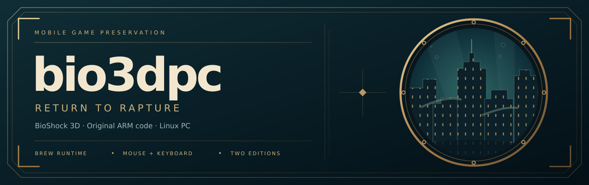
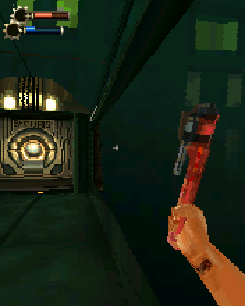
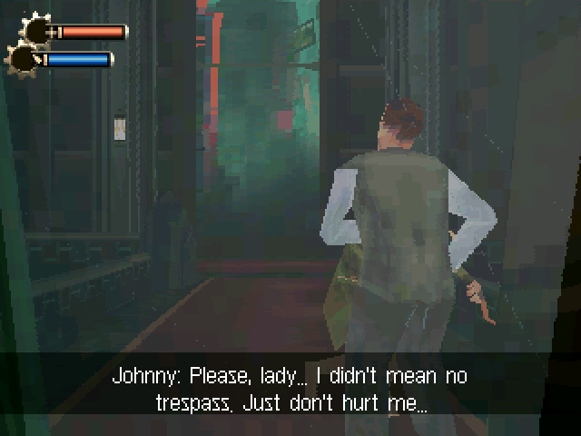
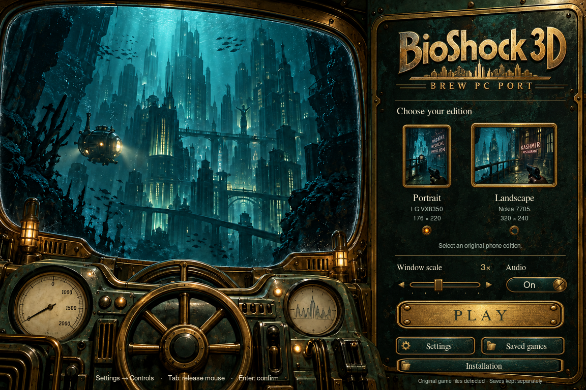
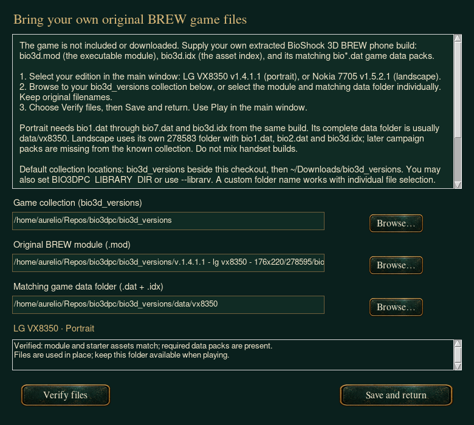
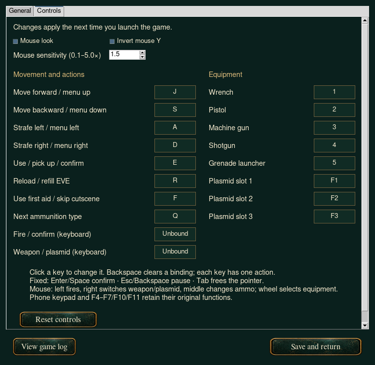

# bio3dpc

[Gameplay](#gameplay) · [Quick start](#quick-start) · [Game files](#installation-bring-your-own-game-files) · [Controls](#playing) · [Development](#development)

Preserve and play **BioShock 3D**, the 2010 BREW mobile game, on a Linux PC.
The native **176×220 portrait LG VX8350** and **320×240 landscape Nokia 7705**
builds have separate profiles and matching applet class IDs. The original ARM
code runs through Unicorn while Python supplies the BREW runtime.

**Bring your own game files.** Original game modules and data are excluded
from this repository; the launcher does not download them.

The original ARM binary is executed unmodified on
[Unicorn](https://www.unicorn-engine.org/): `bio3dpc` plays the part of the
phone (BREW kernel services, display, files, sound, keypad) and shows the
device framebuffer in a tkinter window.

## Gameplay

Actual framebuffer recordings from the original BREW modules running in
bio3dpc, enlarged 2× with nearest-neighbor scaling. The short, silent loops
show portrait gameplay and the landscape opening scene; launcher artwork is
separate from these captures.

| LG VX8350 · 176×220 gameplay | Nokia 7705 · 320×240 opening scene |
| --- | --- |
|  |  |
| v1.4.1.1 · seven matching campaign packs required | v1.5.2.1 · only two campaign packs available |

Both editions reach first-person gameplay. Full campaign completion has not
been verified, and the Nokia collection is missing later campaign packs.
See [build coverage](docs/builds.md) for the exact limits.

## Quick start

On Linux, install Python 3, tkinter and `make`, then:

```bash
git clone https://github.com/aurelioochoa/bio3dpc.git
cd bio3dpc
make venv
./bio3dpc.sh
```

Open **Installation**, select your own matching BREW game files, verify them,
then choose **Play**. FFmpeg and `paplay` enable sound effects;
FluidSynth and a SoundFont additionally enable MIDI music.



Game binaries and game data are copyrighted and are **not** part of this
repository. Point the tools at your own copy of the phone build:

```
tools/play.py --mod "…/bio3d.mod" --data-dir "…/data/vx8350"
```

The **Bathysphere launcher** uses generated brass artwork with a **BREW PC PORT**
title, edition selection, installation guidance, a live window-scale slider, audio switch and saved-game
access. Resize the window freely: narrow windows stack the artwork and controls,
with scrolling when needed. Tab moves between controls; arrows adjust the slider
and switch, and Enter or Space activates a focused button.

The local twelve-second underwater loop runs at 60 fps with smooth refraction
and independent, randomly timed lamp flicker. Animation pauses while the game
runs. Settings includes an animation toggle; without FFmpeg the same controls
remain available over a static background.

```
make venv
./bio3dpc.sh
make install-desktop     # applications-menu entry and ~/.local/bin/bio3dpc
```

Choose the collection folder in **Installation**. Discovery checks a local
`bioshock3d_game_files/` folder, then a collection in `~/Downloads`; override it with
`BIO3DPC_LIBRARY_DIR`. Local original files are ignored by Git. The launcher
verifies the module and starter data hashes so files from unrelated handset
builds are not silently mixed.

PC launches keep saves under `~/.local/state/bio3dpc/saves/<module-sha256>/`
(or `XDG_STATE_HOME`) through a writable overlay. Portrait and landscape saves
stay separate, and original files remain read-only. Launcher preferences live
under `~/.config/bio3dpc/`. `make uninstall-desktop` removes the menu entry and
installed command while preserving preferences, saves and game files.

The Nokia landscape release contains only `bio1.dat` and `bio2.dat`; its later
campaign packs are missing. See [build coverage and selection rationale](docs/builds.md).

## Setup

Python 3 with tkinter (stdlib; developed on 3.14) on **Linux x86_64**. Audio playback uses
`ffmpeg` and `paplay` from `PATH`; MIDI music additionally wants `fluidsynth`
and a SoundFont (see *MIDI*). Everything degrades gracefully when a piece is
missing.

```
make venv            # .venv + requirements.txt (unicorn, capstone, pytest)
make                 # list the targets
```

The default build/data paths live in `tools/boot_check_paths.py`; override them
per run with `make play GAME_DIR="…/<build>" DATA="…/data/vx8350"` or the
`BIO3DPC_GAME_DIR` / `BIO3DPC_DATA_DIR` environment variables.

## Installation: bring your own game files



The game is **not included or downloaded**. Supply your own extracted
**BioShock 3D BREW game files**: `bio3d.mod` is the executable module,
`bio3d.idx` is the asset index, and `bio1.dat`, `bio2.dat`, etc. contain game
data. “Game files” or “BREW module and data” are the terms used here.
Android APKs, iPhone IPAs, Java JARs and console ROM images are unsupported.
Extract any archive before selecting files; keep the original filenames.

1. Run `make venv`, then `./bio3dpc.sh` to open the launcher. Optionally run
   `make install-desktop` for a menu entry and the `bio3dpc` command.
2. Choose **LG VX8350 · Portrait** (v1.4.1.1) or **Nokia 7705 · Landscape**
   (v1.5.2.1) in the main window.
3. Open **Installation** and **Browse…** to your `bioshock3d_game_files` collection.
   The launcher finds the selected edition using the layout below. Alternatively,
   browse directly to the **Original BREW module (.mod)** and **Matching game
   data folder (.dat + .idx)**; individual selection supports other folder names.
4. Choose **Verify files**. Fix any missing-file or mismatched-build errors,
   then **Save and return** and **Play**. Verification checks module and starter
   asset hashes and required pack names; it does not establish full campaign coverage.

Expected collection layout (you only need the edition you intend to play):

```text
bioshock3d_game_files/
  release_builds/
    v.1.4.1.1 - lg vx8350 - 176x220/
      278595/
        bio3d.mod
    v.1.5.2.1 - nokia 7705 - 320x240/
      278583/
        bio3d.mod
        bio3d.idx
        bio1.dat
        bio2.dat
  data/
    vx8350/
      bio3d.idx
      bio1.dat
      bio2.dat
      bio3.dat
      bio4.dat
      bio5.dat
      bio6.dat
      bio7.dat
  development_builds/
    lg9900-v1.5.1.2-build1/
      arm/
      win/
      verification.json
  archives/
    development builds.zip
    data files.zip
```

`release_builds/` holds handset releases, `development_builds/` holds prototypes,
`data/` holds separate campaign packs, and `archives/` preserves downloaded bundles.
The VX9900 prototype has all seven packs matching its bundled index, but has not
been qualified for this port or full campaign playability and is not a launcher edition.

Portrait needs all seven matching packs. If these and the index are beside
`bio3d.mod` instead of in `data/vx8350`, select that directory as the data
folder. The Nokia landscape release has only its first two packs; later
campaign data is missing. Other handset builds' packs are not substitutes.
See [build coverage](docs/builds.md) for the limits of each edition.

Collection discovery checks `bioshock3d_game_files/` beside this checkout, then
the legacy local `bio3d_versions/`, then those two names under `~/Downloads/`.
Older collections with handset folders directly under the collection root remain
supported. Remembered paths into this checkout's renamed collection are migrated
when the launcher loads its settings. For another location, select it in Installation
or start with an explicit override:

```bash
./bio3dpc.sh --library "/path/to/bioshock3d_game_files"
BIO3DPC_LIBRARY_DIR="/path/to/bioshock3d_game_files" ./bio3dpc.sh
```

Unlike the APK/IPA importers in re4mepc and redegpc, bio3dpc **uses files in
place**. It saves the selected paths without copying or changing the game
files. Keep the collection folder or external drive available while playing.
Saves go to `~/.local/state/bio3dpc/saves/<module-sha256>/` (or
`$XDG_STATE_HOME/bio3dpc/saves/<module-sha256>/`), separately for each build.
Preferences are stored under `~/.config/bio3dpc/` (or `$XDG_CONFIG_HOME`).

If verification fails, confirm the selected edition, module and data folder
belong to the same supported build. Selecting the collection's parent folder
as the data folder will not work: choose the directory containing the `.dat`
and `.idx` files. Missing files must come from your own matching copy.

## Status

Working, verified end-to-end:

* boots to the splash → `ENABLE SOUND?` → BioShock logo → main menu
* `NEW GAME` plays the intro (loading card, crash cutscene with subtitles,
  swim sections) and reaches **first-person gameplay with the HUD**
* keyboard input drives menus, cutscenes and gameplay
* the game saves: `savedata.dat` appears in its per-build save overlay and the main
  menu grows a `CONTINUE` entry on the next boot (preferences persist too, so
  the sound question is asked only once)
* audio: QCP/QCELP sounds decode with ffmpeg and play through PulseAudio;
  MIDI music renders through fluidsynth when a SoundFont is present, and its
  duration is parsed in Python either way (see *MIDI*)
* earlier VX8350 measurements put intro and menus at 100–200 guest ticks per wall second; the
  tkinter frontend presents a frame in ≈2.5 ms; gameplay runs ≈19 ticks/s
  (≈38 fps) and is limited by the emulated CPU doing the game's own software
  rasterisation (see `docs/research.md` §7.5)

Known gaps:

* no texture/BMP class (`WINBMP`, `0x01004001`): the game draws with its own
  renderer, so this has not been needed yet
* `MEDIAUTIL` (`0x0100550d`) and `WEB` (`0x01005000`) instances are refused
* MIDI music needs a SoundFont: put one in `~/.local/share/soundfonts/` or set
  `BIO3DPC_SOUNDFONT` (this machine has `TimGM6mb.sf2` there); without one the
  music plays silently but keeps the correct timing
* additional handset builds are inventoried but not qualified for launch;
  the LG VX10000 landscape binary also requires an EGL/GLES implementation

## Playing

```
.venv/bin/python tools/play.py                     # window, default paths
.venv/bin/python tools/play.py --profile n7705      # native landscape build
.venv/bin/python tools/play.py --scale 2           # smaller window
BIO3DPC_AUDIO=0 .venv/bin/python tools/play.py     # silent
```

Close the window (or hit Ctrl+C in the terminal) to quit.

The bindings follow the [original PC manual](https://shared.akamai.steamstatic.com/store_item_assets/steam/apps/7670/manuals/manual_en.pdf)
for actions available in this mobile build. The table shows the defaults;
use **Settings → Controls** in the launcher to change keyboard bindings:

| PC control | action |
| --- | --- |
| W / S | move forward / backward; up / down in menus |
| A / D | strafe left / right; left / right in menus |
| mouse | turn and look up/down, without changing movement direction |
| LMB | fire the current weapon/plasmid; confirm in menus |
| RMB | toggle between the current weapon and plasmid; back in menus |
| E | use / pick up; confirm prompts |
| R / F | reload or refill EVE / use first aid |
| 1–5 | select an owned weapon (wrench, pistol, machine gun, shotgun, grenade launcher) |
| F1–F3 | select an owned plasmid in gameplay |
| wheel up / down | next / previous owned weapon or plasmid in the current mode |
| Q / middle click | next available ammunition type |
| Enter / Space / KP_Enter | OK / confirm prompts |
| Esc / Backspace | pause / back |
| Tab | release / capture the pointer |
| numeric keypad 0–9 | original phone keypad, with Num Lock on or off |
| F1–F4 in menus | phone soft keys; F2 skips cutscenes |
| F10 / F11 | phone soft keys 1 / 2 in every context (F11 also skips cutscenes) |
| F5–F7 | phone function keys 1–3 |
| arrows | phone d-pad; up/down also aim in gameplay |
| Home / End, `*` / `#` | phone SEND / END, star / pound |

This is the mobile game, with five weapons and three plasmid slots. There are
no separate PC bindings for jump, zoom, a radial selection screen, or quicksave/quickload.
Space sends the phone's OK key; the original help also labels OK as crouch.
The top number row selects equipment in gameplay;
use the numeric keypad when following the phone's numbered hints or hacking
controls. Equipment must have been acquired before it can be selected.

### Control settings



Open **Controls** on the launcher (or **Settings → Controls**) to enable mouse
look, adjust sensitivity from **0.1× to 5.0×** with the slider or number field,
invert the vertical mouse axis, or rebind movement, actions,
weapons and plasmid slots. Optional keyboard bindings for firing and switching
weapon/plasmid start unbound; mouse buttons keep their default actions.

Click an action's key button and press the replacement key. **Backspace** clears
that binding; **Escape** cancels capture. Letters, numbers, arrows, Page Up/Down,
Insert/Delete and F1–F3/F8/F9/F12 are supported. Each key can have one action;
clear an existing assignment before reusing it. **Reset controls** restores all
keyboard and mouse defaults. **Save and return** persists changes for the next
game launch, including launches from `make play` and `tools/play.py`.

Enter/Space, Escape/Backspace, Tab, the numeric keypad and F4–F7/F10/F11 retain
their fixed functions. Rebound movement/use keys also navigate menus; equipment
selection still requires owned items. Settings are stored in
`~/.config/bio3dpc/launcher.json` (or `$XDG_CONFIG_HOME/bio3dpc/launcher.json`).

Mouse look is enabled by default. Command-line overrides affect that session:
`--no-mouse` / `--mouse`, `--mouse-sens 2.0` (double sensitivity), and
`--invert-y` / `--no-invert-y`. For example:

```bash
.venv/bin/python tools/play.py --mouse-sens 2.0 --invert-y
```

In game menus the pointer stays visible. Hover highlights a row; left click
activates it, right click goes back, and the wheel moves through entries or
scrolls text. In Options, hover Volume and use the wheel to adjust it.
Blank areas of a menu do not activate the selected row.

During gameplay the pointer is hidden, confined to the game window on X11/Xwayland,
and recenters near the edges so fast turns keep working.
Tab frees it; a click captures it again without firing. Losing focus releases
every input. Escape releases the pointer when pausing, and resuming gameplay
captures it again.

On the verified portrait and landscape builds, relative mouse travel calls the
game's native camera rotation methods once per host slice, including fractional
steps (52 horizontal or 64 vertical host pixels per original look step at 1×
sensitivity). Travel is consumed immediately, so a flick leaves no queue of
turn-key holds after the mouse stops. Pitch keeps the native viewing limits.
The default mouse speed is one quarter of the earlier rate. Walking forward
or backward preserves mouse pitch; the phone's automatic leveling is suppressed
while mouse look is enabled. Native keypad look keeps automatic leveling when
mouse look is disabled.
Unknown builds retain the phone-key fallback. Physical keys and mouse buttons
share ownership of guest keys; releasing one alias does not cancel another.
Even a short click waits until the guest queries that key.

Context and equipment selection use separate hash-guarded VX8350 and Nokia profiles.
Other module images retain native phone-key bindings without reading unknown
guest structures. Equipment selection sends the game's own cycle keys and
waits for its equip animation; the emulator does not alter inventory or original
module files. The [mobile control reference](https://bioshock.fandom.com/wiki/BioShock_3D_%28Mobile_Game%29)
and live guest checks establish the phone bindings.

In game the build prints its own hints: `PRESS (2) TO MOVE AHEAD`, `(8) TO MOVE
BACK`, `PRESS OK …` at the swimming/lighthouse/bathysphere prompts and
`SKIP [RSK]` on cutscenes — F2 or F11 skips the intro, which otherwise takes a few
minutes of `OK`s and one `UP` (hold it at `PRESS UP TO SWIM UP`).

## Layout

| path | what it is |
| --- | --- |
| `bio3dpc/machine.py` | Unicorn ARM core, guest calls, traps, guest allocator |
| `bio3dpc/services.py` | BREW classes: IShell, IDisplay, IBitmap, IFileMgr, IMemAStream, IImage(PNG), ISoundPlayer, … |
| `bio3dpc/boot.py` | boot lifecycle: load module, create applet, `EVT_APP_START`, pump |
| `bio3dpc/controls.py` | verified guest context and owned equipment (read only) |
| `bio3dpc/input_settings.py` | saved mouse preferences and keyboard bindings |
| `bio3dpc/frontend.py` | tkinter window: framebuffer → PPM image, keyboard/mouse input → `EVT_KEY` |
| `bio3dpc/profiles.py` | original build identities, dimensions, class IDs and matching assets |
| `bio3dpc/launcher.py`, `bathysphere.py` | live Bathysphere edition selector and settings |
| `bio3dpc/animation.py` | asynchronous, bounded local video playback |
| `bio3dpc/desktop.py` | per-user desktop installation and removal |
| `bio3dpc/audio.py` | QCP/MIDI → WAV (ffmpeg / fluidsynth) → `paplay` |
| `bio3dpc/midi.py` | Standard MIDI File duration parser (tempo map) |
| `bio3dpc/png.py` | pure-Python PNG decoder (the game's font arrives as PNG) |
| `Makefile` | `make` entry points: venv, test, play, screenshots, disassembly |
| `tools/play.py` | play in a window |
| `tools/key_test.py` | scripted sessions with screenshots |
| `tools/auto_play.py` | presses keys whenever the screen settles |
| `tools/screenshot.py` | dump the device bitmap to a PNG |
| `tools/frontend_check.py` | headless smoke test of window + keys |
| `tools/mouse_check.py` | smoke test of mouse capture, look deltas, warps, buttons |
| `tools/input_check.py` | real Tk and guest gameplay input checks, with isolated saves |

## Development

Before publishing changes, stage the intended files and run
`.venv/bin/python tools/check_publish.py`. It checks the Git index for game
files, archives, local credentials, oversized files and common secret patterns.
GitHub Actions repeats that audit, checks the README media and runs the tests
without original game files. See [publishing notes](docs/publishing.md).

To recreate the README gameplay captures from your own supported collection:

```bash
.venv/bin/python tools/capture_gameplay.py
.venv/bin/python tools/check_publish.py --media
```

Capture uses temporary saves and the same camera methods as mouse look.

`make` (no arguments) lists everything; the common ones:

```
make test                                  # unit and regression tests
make play                                  # window; SCALE=2 for a smaller one
make smoke                                 # window + keys + frames smoke test
make mouse                                 # mouse capture/look/warp smoke test
make input                                 # real gameplay controls; isolated saves
make shot SECS=30                          # screenshot after 30 s
make series SECS=40                        # screenshot every 5 s
make keys AT=8 KEYS=SELECT,WAIT,SOFT2      # scripted session
make auto PLAN=SELECT,SELECT,SELECT,UP     # press keys when the screen settles
make boot SECS=10                          # boot report + service-call histogram
make disasm OFFSET=0x5a658                 # guest disassembly
make clean                                 # caches; clean-artifacts drops OUT
```

Artifacts land in `OUT` (`/tmp/opencode/bio3dpc` by default). Anything settable
as a variable (`GAME_DIR`, `DATA`, `MOD`, `SECS`, `AT`, `KEYS`, `PLAN`, `SCALE`)
can also be passed on the command line.

The underlying tools still work standalone:

```
.venv/bin/python tools/screenshot.py --seconds 30 --out shot.png
.venv/bin/python tools/key_test.py --at 8 --keys SELECT,WAIT --out /tmp/sess
```

`docs/research.md` collects the reverse-engineering notes (build layout, BREW
ABI details, the event/key codes the game reacts to, and the open questions).
Current build decisions are in `docs/builds.md`; the REA/Ghidra investigation
and evidence IDs are in `docs/rea-workflow.md`. `docs/launcher-art.md` explains
the generated artwork and reproducible FFmpeg video render. REA and its native
analysis engines are development tools and are not needed to play.

## MIDI

The game's music is Standard MIDI (format 1). `bio3dpc` parses the tempo map
to learn how long a tune runs — that is what `ISoundPlayer` needs to deliver
`AEE_SOUNDPLAYER_DONE` — and renders it when a SoundFont is available:

```
BIO3DPC_SOUNDFONT=/usr/share/soundfonts/FluidR3_GM.sf2 .venv/bin/python tools/play.py
```

Without one the music is silent; sound effects and voices still play.  Any
`*.sf2` under `~/.local/share/soundfonts/` is picked up automatically.

## Credits and game files

BioShock and BioShock 3D belong to their respective rights holders. This is
an unofficial preservation project with no affiliation or endorsement.
Original modules, data, SDK headers, extracted sounds and fonts are not
distributed here. The README gameplay media consists of rendered captures;
the launcher artwork is generated, as documented in [launcher art](docs/launcher-art.md).
Unicorn, Pillow and the other dependencies retain their own licenses.
